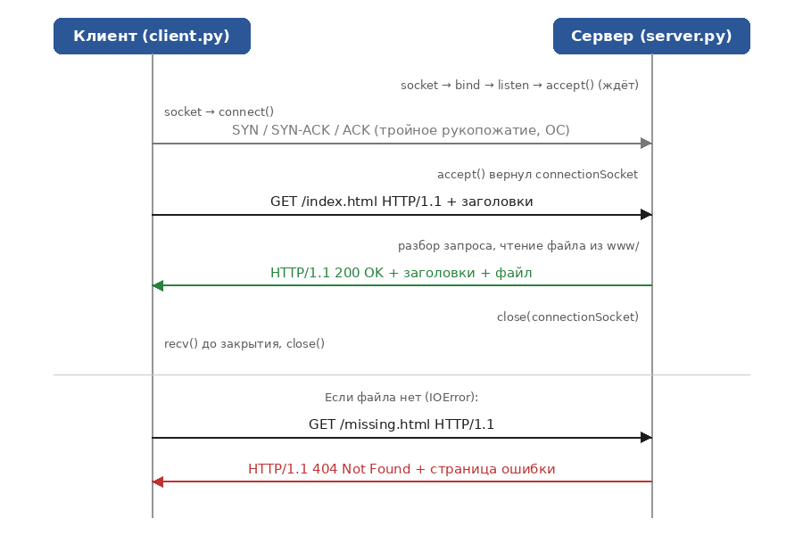
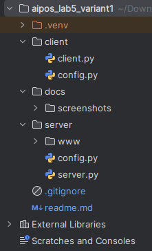
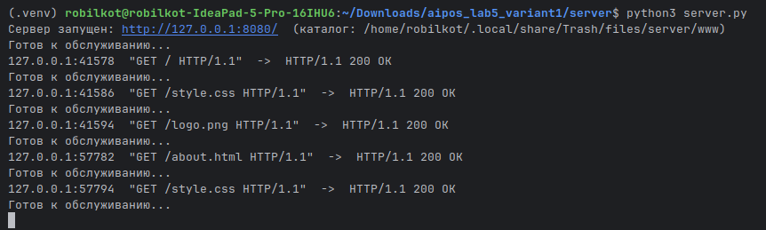
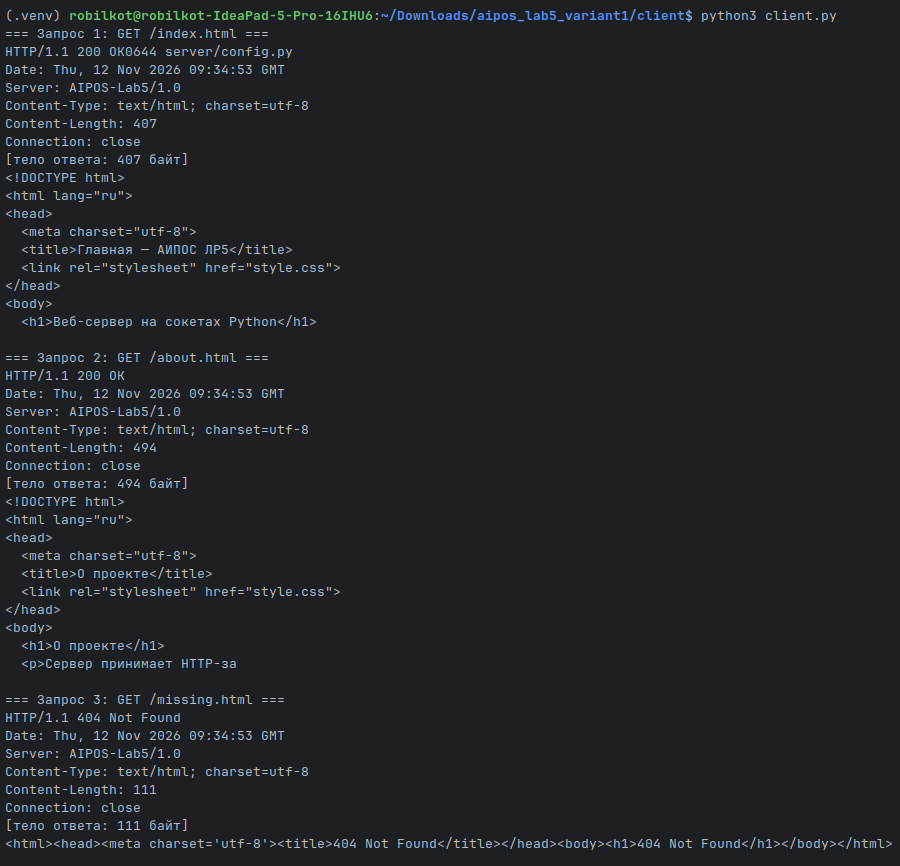
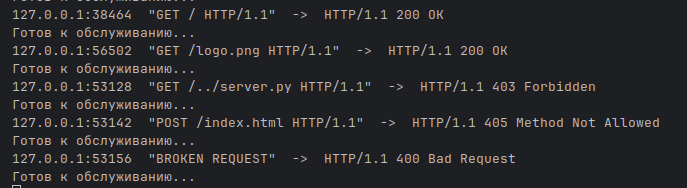
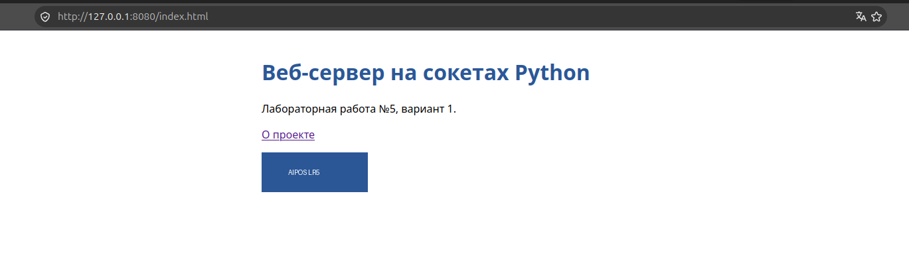
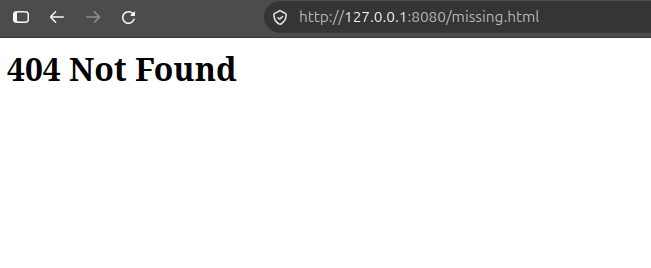

<div align="center">

# ОТЧЁТ

## по лабораторной работе №5

**«Программирование сокетов: веб-сервер на Python»**

по дисциплине **«Аппаратное и программное обеспечение сетей»**

**Вариант 1**

</div>

**Выполнил:** студенты гр. [421702] [Адамович К.В. Щурко А.А.] 

**Проверил:** [Литвинчук Ю.А.]

---

## Содержание

1. [Цель работы](#1-цель-работы)
2. [Теоретические сведения](#2-теоретические-сведения)
3. [Постановка задачи](#3-постановка-задачи)
4. [Архитектура решения](#4-архитектура-решения)
5. [Структура проекта](#5-структура-проекта)
6. [Формат HTTP-сообщений](#6-формат-http-сообщений)
7. [Запуск](#7-запуск)
8. [Результаты работы](#8-результаты-работы)
9. [Ключевые моменты реализации](#9-ключевые-моменты-реализации)
10. [Выводы](#10-выводы)
11. [Контрольные вопросы](#11-контрольные-вопросы)

---

## 1. Цель работы

Познакомиться с основами программирования сокетов на языке Python и реализовать простой веб-сервер на основе протокола **TCP**, работающий по протоколу прикладного уровня **HTTP**.

---

## 2. Теоретические сведения

**Сетевое приложение** состоит из клиентской и серверной программ, которые работают на разных конечных системах и обмениваются сообщениями через **сокеты**. Сокет — это интерфейс между процессом приложения и транспортным уровнем («дверь» процесса). Приложение управляет всем, что находится со стороны прикладного уровня, а транспортный уровень обеспечивает ОС.

**HTTP** — протокол прикладного уровня, описанный в RFC. Он работает по принципу «запрос — ответ»: клиент (браузер) отправляет запрос с методом и путём к ресурсу, сервер возвращает код состояния и содержимое ресурса. Сообщения HTTP — текстовые; строки разделяются парой символов `\r\n`, а заголовки от тела — пустой строкой.

**TCP** — протокол транспортного уровня с установлением соединения. Перед обменом данными клиент и сервер выполняют **тройное рукопожатие**; затем TCP гарантирует доставку каждого байта в правильном порядке. HTTP требует именно такой надёжности, поэтому веб-сервер строится на TCP-сокетах (`SOCK_STREAM`), в отличие от UDP (`SOCK_DGRAM`), который работает без соединения и не гарантирует доставку.

**Два сокета на стороне TCP-сервера:**

- *входной сокет* (`serverSocket`) — принимает запросы на установление соединения от любых клиентов;
- *сокет соединения* (`connectionSocket`) — создаётся методом `accept()` для каждого конкретного клиента и используется для обмена данными с ним.

---

## 3. Постановка задачи

Согласно варианту 1 необходимо создать веб-сервер, который способен обработать несколько HTTP-запросов (работа проверяется на трёх). Веб-сервер должен:

1. принять и проанализировать HTTP-запрос;
2. получить требуемый файл из файловой системы сервера;
3. создать ответное HTTP-сообщение, состоящее из запрошенного файла и предваряющих его строк заголовка;
4. отправить ответ непосредственно клиенту;
5. если требуемый файл на сервере отсутствует — вернуть клиенту сообщение **404 Not Found**.

### Доработка

- Настройки сервера и клиента вынесены в отдельные файлы `config.py`.
- Формируются корректные заголовки `Content-Type` и `Content-Length` (тип определяется по расширению файла); поддерживаются бинарные файлы (изображения).
- Обработка ошибочных ситуаций: `400 Bad Request`, `403 Forbidden` (защита от выхода за пределы каталога `www`, например `/../server.py`), `405 Method Not Allowed` (поддерживается только метод `GET`).
- Запрос `/` отдаёт файл `index.html`.
- Ошибка при обработке одного клиента не останавливает сервер.
- Написан тестовый клиент, отправляющий три запроса: два успешных и один на несуществующий файл.

---

## 4. Архитектура решения

Используется транспортный протокол **TCP** (`SOCK_STREAM`):

- сервер: `socket` → `bind` → `listen` → цикл `accept`;
- на каждый запрос `accept()` создаёт новый сокет соединения, а входной сокет остаётся открытым для следующих клиентов;
- тройное рукопожатие выполняет операционная система на транспортном уровне и невидимо для программ.

### Алгоритм обработки запроса

```
accept() -> recv() запроса -> разбор строки "МЕТОД ПУТЬ ВЕРСИЯ"
   |-- формат неверен ............. 400 Bad Request
   |-- метод не GET ............... 405 Method Not Allowed
   |-- путь вне каталога www ...... 403 Forbidden
   |-- файл не открывается ........ 404 Not Found   (перехват IOError)
   '-- иначе ...................... 200 OK + заголовки + содержимое файла
-> sendall() ответа -> close() сокета соединения
```

### Диаграмма последовательности обмена



---

## 5. Структура проекта



| Путь                | Назначение                                                                    |
|---------------------|-------------------------------------------------------------------------------|
| `server/server.py`  | Веб-сервер: приём соединений, разбор запроса, формирование ответа             |
| `server/config.py`  | Порт, размер буфера, кодировка, каталог с файлами                             |
| `server/www/`       | Файлы, доступные клиентам: `index.html`, `about.html`, `style.css`, `logo.png` |
| `client/client.py`  | Тестовый клиент: отправляет HTTP-запросы и печатает ответы                    |
| `client/config.py`  | Адрес и порт сервера, список путей для запросов                               |
| `docs/screenshots/` | Скриншоты и диаграммы для отчёта                                              |

---

## 6. Формат HTTP-сообщений

**Запрос (клиент → сервер):**

```
GET /index.html HTTP/1.1\r\n
Host: 127.0.0.1:8080\r\n
Connection: close\r\n
\r\n
```

**Ответ (сервер → клиент):**

```
HTTP/1.1 200 OK\r\n
Date: Thu, 12 Nov 2026 12:00:00 GMT\r\n
Server: AIPOS-Lab5/1.0\r\n
Content-Type: text/html; charset=utf-8\r\n
Content-Length: 407\r\n
Connection: close\r\n
\r\n
<содержимое файла>
```

Если файл не найден — статусная строка `HTTP/1.1 404 Not Found` и короткая HTML-страница с текстом ошибки.

---

## 7. Запуск

Требуется Python 3.8+, сторонние библиотеки не нужны.

### 7.1. Сервер

```
cd server
python3 server.py
```

Сервер слушает порт `8080` (меняется в `server/config.py`). Остановка — `Ctrl+C`.

### 7.2. Тестовый клиент

В `client/config.py` укажите адрес сервера:

```
SERVER_NAME = "127.0.0.1"        # локально
# SERVER_NAME = "185.253.45.38"  # пример: сервер на VDS
SERVER_PORT = 8080
```

Запуск (в другом терминале):

```
cd client
python3 client.py                 # три запроса из config.py
python3 client.py /logo.png       # произвольные пути аргументами
```

### 7.3. Браузер

Откройте `http://127.0.0.1:8080/` — отобразится главная страница с картинкой и стилями (браузер сам выполнит три запроса: `index.html`, `style.css`, `logo.png`). Страница `http://127.0.0.1:8080/nofile.html` вернёт 404.

## 8. Результаты работы

### 8.1. Запуск сервера и обработка трёх запросов

Лог сервера — по одной строке на каждый запрос (адрес клиента, строка запроса, статус ответа):



### 8.2. Тестовый клиент: три запроса

| № | Запрос              | Результат                       |
|---|---------------------|---------------------------------|
| 1 | `GET /index.html`   | `200 OK`, 407 байт, `text/html` |
| 2 | `GET /about.html`   | `200 OK`, 494 байта, `text/html`|
| 3 | `GET /missing.html` | `404 Not Found`, файла нет      |



### 8.3. Дополнительные проверки

| Запрос                | Результат                                |
|-----------------------|------------------------------------------|
| `GET /`               | `200 OK` (отдан `index.html`)            |
| `GET /logo.png`       | `200 OK`, `image/png` (бинарный файл)    |
| `GET /../server.py`   | `403 Forbidden` (выход за пределы `www`) |
| `POST /index.html`    | `405 Method Not Allowed`                 |
| некорректный запрос   | `400 Bad Request`                        |



### 8.4. Проверка в браузере

 


---

## 9. Ключевые моменты реализации

### Сервер

- `socket(AF_INET, SOCK_STREAM)` — IPv4 + TCP; опция `SO_REUSEADDR` позволяет быстро перезапускать сервер на том же порту;
- `bind` / `listen` — подготовка входного сокета; `accept` — создание сокета соединения для клиента;
- чтение запроса циклом `recv` до пустой строки `\r\n\r\n` (конец HTTP-заголовков);
- `message.split()[1]` — извлечение пути из строки запроса; `urlsplit` и `unquote` — разбор URL;
- `open(path, "rb")` и `except IOError` — отсутствие файла приводит к ответу 404;
- файлы читаются в бинарном режиме, поэтому изображения передаются без повреждений;
- `Content-Length` сообщает размер тела, `Connection: close` — соединение закрывается после ответа;
- `sendall` + `close` сокета соединения; входной сокет остаётся открытым;
- запросы обрабатываются последовательно, по одному (многопоточный вариант — тема варианта 2).

### Клиент

- `connect((SERVER_NAME, SERVER_PORT))` — установка TCP-соединения (тройное рукопожатие);
- формирование текстового HTTP-запроса и отправка через `sendall`;
- чтение ответа циклом `recv` до закрытия соединения сервером;
- разделение ответа на заголовки и тело по `\r\n\r\n`.

---

## 10. Выводы

1. Реализован веб-сервер на сокетах Python с использованием **TCP** и формата сообщений **HTTP**.
2. Сервер разбирает запрос, читает файл из файловой системы и формирует ответ с заголовками; при отсутствии файла возвращает `404 Not Found`.
3. Работа проверена тремя запросами и дополнительными сценариями (бинарный файл, `403`, `405`, `400`).
4. Получены практические навыки работы с методами `bind`, `listen`, `accept`, `recv`, `send` и разбора текстового протокола прикладного уровня.

---

## 11. Контрольные вопросы

| Вопрос | Ответ |
|--------|-------|
| Что такое сокет? | Интерфейс между приложением и транспортным уровнем; «дверь» процесса. |
| Почему веб-сервер использует TCP? | HTTP требует надёжной доставки данных в правильном порядке; TCP это гарантирует. |
| Зачем два сокета на стороне сервера? | `serverSocket` принимает запросы на соединение; `accept()` создаёт для каждого клиента отдельный `connectionSocket`. |
| Где происходит тройное рукопожатие? | На транспортном уровне ОС при `connect()` на клиенте и `accept()` на сервере; для программ оно невидимо. |
| Из чего состоит HTTP-запрос? | Строка запроса (метод, путь, версия), заголовки, пустая строка, необязательное тело. |
| Из чего состоит HTTP-ответ? | Статусная строка (версия, код, пояснение), заголовки, пустая строка, тело. |
| Что означает код 404? | Запрошенный ресурс на сервере не найден. |
| Для чего нужен `Content-Length`? | Сообщает клиенту размер тела ответа. |
| Чем отличается от UDP-эхо-сервера? | Здесь TCP (соединение, надёжность) и протокол HTTP; в UDP нет соединения и гарантий доставки. |
| Почему порт 8080, а не 80? | Порт 80 — стандартный для HTTP, но порты ниже 1024 требуют прав администратора. |
| Для чего проверка пути на `/../`? | Чтобы клиент не мог прочитать файлы за пределами каталога `www`. |
| Обслуживает ли сервер клиентов одновременно? | Нет, последовательно; для параллельной работы нужны потоки или процессы (вариант 2). |

---

